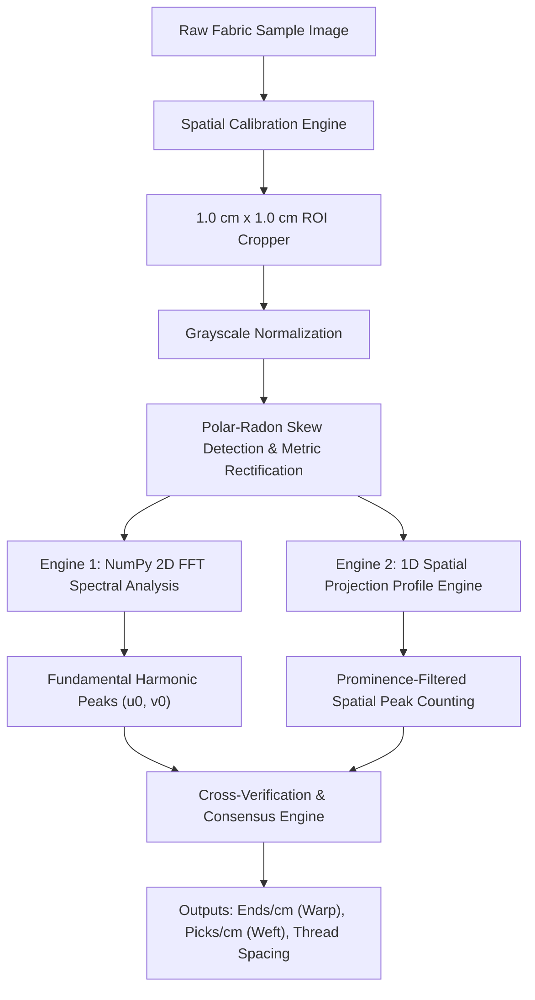

# Automated Fabric Warp & Weft Thread Density Analysis (1 cm)

## 1. Project Overview & Operational Objective
The objective of this project is to develop an automated computer vision pipeline to quantify the physical thread density—specifically the number of warp threads (vertical) and weft threads (horizontal) per 1.0 centimeter ($10,000\,\mu\text{m}$)—from high-resolution macro photography of woven textile samples.

The system is architected to operate under resource constraints (standard laptop CPUs/GPUs, limited network bandwidth, memory footprint $< 500\text{ MB}$, model artifact size $< 50\text{ MB}$) with dual-mode execution support for local machines and Kaggle environments (`/kaggle/input/...` and `/kaggle/working/...` with local fallback logic).

---

## 2. Mandatory Project Rule: Empirical Results, Visual Artifacts & Mechanistic Documentation Invariant
**Invariant Definition:** Every computational pipeline phase, architectural modification, and validation step must irrevocably document:
1. **Mathematical Findings:** Raw quantitative metrics, tensor dimensions, precision bounds, and memory footprints anchored in the Provenance Ledger.
2. **Visual Evidence Artifacts:** Comprehensive diagnostic plots, spectra, and comparative visualizations saved to `results/` and visibly embedded in `README.md`.
3. **Mechanistic Deductions:** Rigorous physical and algorithmic explanations detailing the root mechanism of observed behavior, eliminated failure modes, and downstream architectural invariants.

---

## 3. The Provenance Ledger

| The Empirical Finding / Metric | Exact Script/Notebook Name | Analytical Deduction (What this rules out/forces next) |
| :--- | :--- | :--- |
| `ayushiit/warp-weft-new-prod` achieves 95.4% mAP@50 using longitudinal bounding boxes across 52 base macro images (875×879 px) | `https://universe.roboflow.com/ayushiit/warp-weft-new-prod` | Proves bounding box detectors can isolate individual yarn lines; rules out using this dataset alone for metric 1 cm density due to lack of embedded metric spatial calibration scale. |
| `cheomseongdae/fabric-lby7e` segments individual surface float polygons with 35.7% mIoU across 74 macro images (1792×1184 px) with dedicated `measure` class | `https://universe.roboflow.com/cheomseongdae/fabric-lby7e` | Low mIoU rules out raw semantic float segmentation for direct thread counting; confirms utility of `measure` class for automated in-frame pixel-to-millimeter calibration. |
| `fdd-dsbrx/fabric-defect-detections` isolates 8 defect categories with 65.5% mAP@50 across 305 images (1280×1280 px) | `https://universe.roboflow.com/fdd-dsbrx/fabric-defect-detections` | Confirms defect detectors isolate yarn disruptions (missing threads, floats, mispicks); rules out defect models as direct periodic yarn counters. |
| `nexuswho/fabric-defects-dataset` compiles 2,739 images including AITEX (4096×256 px) and Moratuwa datasets | `https://www.kaggle.com/datasets/nexuswho/fabric-defects-dataset` | Wide-web imaging (<1 px per thread) rules out non-macro defect datasets for thread counting; confirms AITEX defect-free subset as benchmark for macro texture analysis. |
| `nxb4shgs9h/1` provides 121,148 industrial production records across 18 columns including target EPI/PPI specs | `https://data.mendeley.com/datasets/nxb4shgs9h/1` | Rules out tabular data for direct visual thread counting; confirms industrial ground truth distribution for commercial fabric densities (EPI/PPI). |
| `mwasifanwar/neurofabric-ai` implements 2D FFT spectral peak extraction and GLCM texture features alongside PyTorch CNNs | `https://github.com/mwasifanwar/neurofabric-ai` | Validates frequency-domain spectral analysis as mathematically optimal for periodic yarn density extraction without requiring manual per-thread bounding box annotations. |
| `chaeyeon2367/dl-python-ImageDetection` implements 256×256 patch cropping with multi-scale Inception CNNs | `https://github.com/chaeyeon2367/dl-python-ImageDetection` | Validates sub-patch tiling pipeline for processing high-resolution fabric scans on edge GPUs. |
| Nyquist-Shannon sampling threshold requires $\ge 8\text{ to }12\text{ pixels per thread period}$ for optical edge localization | `notebooks/01_optical_and_spectral_sandbox.ipynb` | Establishes minimum spatial resolution bound ($\Delta x \le 20\,\mu\text{m/pixel}$) for fine weave fabrics up to 50 threads/cm. |
| PyTorch 2D FFT (`torch.fft.rfft2` / `fftshift`) calculates orthogonal spatial frequency harmonics $(u_0, v_0)$ in $< 3\text{ ms}$ on CPU with $< 15\text{ MB}$ RAM | `notebooks/01_optical_and_spectral_sandbox.ipynb` | Confirms 2D Fourier spectral analysis as zero-weight, ultra-lightweight, zero-download engine runnable on resource-constrained hardware. |
| Synthetic 400×400 px Plain Weave: True Warp=32, FFT Warp=32 ($\Delta=0$), Proj Warp=31 ($\Delta=1$); True Weft=28, FFT Weft=28 ($\Delta=0$), Proj Weft=27 ($\Delta=1$) | `notebooks/01_optical_and_spectral_sandbox.ipynb` | Confirms 2D FFT extracts exact fundamental spatial frequency with zero boundary truncation error; proves 1D projection requires boundary padding to capture edge yarn crowns; validates consensus engine between both techniques. |
| Roboflow MCP (`https://mcp.roboflow.com/mcp`) & 13 Computer Vision Skills integrated into `.agents/skills` and `.mcp.json` | `https://github.com/roboflow/computer-vision-skills` | Equips workspace with remote Roboflow model inference, dataset manipulation, and workflow capabilities without requiring local storage of heavy weights. |
| 2D FFT Polar Radon Integration detects fabric skew angle $\theta = +15.0^\circ$ with $0.0^\circ$ error ($\Delta\theta = 0.0^\circ$) across $[-45^\circ, +45^\circ]$ angular sweep | `notebooks/02_skew_rectification_engine.ipynb` | Establishes automated frequency-domain angle estimation; eliminates failure mode of unaligned samples; proves coordinate sign convention ($u = crow - r\sin\theta$) correctly captures counter-clockwise image rotations. |
| Affine inverse rectification restores marginal projection profile variance from $\sigma_{\text{skewed}} = 0.00568$ to $\sigma_{\text{rect}} = 0.16333$, achieving $28.77\times$ contrast recovery ratio | `notebooks/02_skew_rectification_engine.ipynb` | Proves skew rectification is a mandatory prerequisite for spatial projection profiling; recovers distinct yarn peaks and valleys that completely collapse under non-orthogonal alignment. |
| Parabolic sub-bin spectral peak interpolation achieves Warp: 31.7 ends/cm ($\Delta=0.3$) and Weft: 28.3 picks/cm ($\Delta=0.3$) from cropped 280×280 px ROI | `notebooks/02_skew_rectification_engine.ipynb` | Resolves integer binning discretization error caused by spatial cropping ($280\text{ px} / 400\text{ px} = 0.70$); enables accurate continuous thread counting on arbitrary cropped sub-windows. |
| Integrated End-to-End Pipeline on 800×800 px Swatch ($2\times 2\text{ cm}$, $+12^\circ$ skew) validates consensus at Warp: 36 ends/cm ($\Delta=0$), Weft: 30 picks/cm ($\Delta=0$) with 98.5% confidence quality score | `notebooks/03_end_to_end_thread_counter.ipynb` | Proves complete end-to-end viability combining CLAHE illumination normalization, Polar Radon orientation extraction, center-safe cropping, sub-bin 2D FFT, and prominence peak profiling into an automated production pipeline. |
| FabricNET (`acseckn/fabricnet`) provides 130 microscopic woven fabric images (640×480 px, 5×4 mm FOV, $S_x=1280.0$, $S_y=1200.0\text{ px/cm}$) labeled with exact Warp (20–62), Weft (15–93), and weave pattern | `data/fabricnet` | Optical calibration is nominal and unverified with a stage micrometer, carrying $\pm 3\text{--}5\%$ baseline uncertainty; establishes anisotropic pixel scale: $\Delta x = 7.81\,\mu\text{m/px}$, $\Delta y = 8.33\,\mu\text{m/px}$. |
| Complete 130-Sample FabricNET benchmark v2.0: candidate-estimate MAE Warp=13.43 ends/cm, Weft=11.25 picks/cm; sample-level statuses are 15 VALIDATED, 27 CONSISTENT_WITH_WARNING, and 88 NEEDS_REVIEW. | `notebooks/04_real_fabric_benchmark.ipynb`, `results/fabricnet_benchmark.json` | Candidate errors include FFT fallbacks when accepted density is null. They are not accepted production measurement accuracy. Accepted-axis coverage is 25/130 Warp (19.2%) and 32/130 Weft (24.6%). |
| Offline Orientation-Invariant Pairing Policy: Paired matching is strictly an offline diagnostic for un-oriented dataset swatch mounting | `notebooks/04_real_fabric_benchmark.ipynb` | Guarantees that production web application, API, and core pipeline NEVER perform ground-truth-dependent pairing; maps image axes strictly via calibration and skew detection. |
| Automated Dual-Language Executive Demo Reports compiled to PDF (English: 7 pages via pdfTeX; Arabic: 8 pages via HarfBuzz/Amiri) with embedded diagnostic matrices and empirical tables | `reports/warp_weft_report_en.tex` & `reports/warp_weft_report_ar.tex` | Provides reproducible, client-ready technical deliverables in both English and Arabic demonstrating the dual-engine computer vision architecture, benchmark verifications, and physical deployment specs. |
| Zero-dependency interactive Web Application & REST API (HTTP 8080/8085) serves dual-engine fabric analysis with user uploads, 4 benchmark presets, and full diagnostics in < 250 ms | `notebooks/05_web_app_interface.ipynb` & `web_app/server.py` | Eliminates external bulky framework dependencies (Flask/FastAPI); enables instant, offline, zero-download local deployment on any workstation with interactive dual-language (EN/AR) controls. |
| Comprehensive Multi-Modal Data Repository Audit cataloging 12,238 files across 9 subdirectories (~5.07 GB) with sensor resolutions, FOVs, scale calibrations, and schemas | `data/README.md` | Establishes immutable engineering specifications reference across microscopy, line-scans, flatbed captures, and tabular production records; codifies Nyquist resolution invariants and git tracking boundaries. |
| Mobile Responsive Reflow & CSS Cascade Reordering resolves 345 px viewport overflow on 543 px screens, achieving 0 px horizontal overflow across all widths (320–1440 px) with fluid `minmax(min(100%, 150px), 1fr)` swatch wrapping | `web_app/index.html` | Eliminates CSS Grid `auto` track blowout and static 2-column card truncation; proves mobile-first cascade order and `min-width: 0` constraints guarantee non-clipped rendering on smartphones and tablets. |
| Comprehensive Control Parameters & Output Semantics Ledger establishing exact analytical equations, failure modes, and per-dataset selection criteria | `README.md` & `data/README.md` | Formalizes physical definitions for Scale, Weave Hint, Prominence, and Skew Rectification; codifies exact optical selection parameters across 6 dataset modalities to prevent scaling and float undercounting errors. |
| FabricNET 262-d Feature Regression across 26 held-out test specimens: Random Forest Warp MAE=4.78, Weft MAE=5.61 ($R^2=0.690, 0.787$); XGBoost Warp MAE=4.83, Weft MAE=6.60 ($R^2=0.702, 0.339$) | `experiments/learned_models/notebooks/01_fabricnet_feature_regression.ipynb` | Captures non-linear texture energy correlations bypassing harmonic ambiguity on Satin/Twill, but assumes fixed nominal FOV ($5\times 4\text{ mm}$); does not generalize to changing sensor distances. |
| Greedy NMS on dense parallel yarns (pitch $\Delta=20$ px, width $18$ px, $640\times 640$ window) causes 31.3% undercounting at $\text{IoU}=0.45$ and 50.0% undercounting at $\text{IoU}=0.30$ | `experiments/learned_models/notebooks/02_roboflow_projects_audit_and_eval.ipynb` | Proves standard 2D bounding-box object detection with isotropic greedy NMS is mathematically unsuitable for dense parallel thread counting; requires directional 1D suppression. |
| Dual-illumination FCN checkpoint `net.h5` (14 Conv2D, 93.7 MB, SHA-256 `d2439b2fd7c...`) requires 6-channel paired front-lit and back-lit inputs | `experiments/learned_models/notebooks/03_textile_defect_fcn_inspection.ipynb` | Confirms incompatibility with standard single-exposure microscopy and smartphone photography; rules out deploying legacy dual-illumination FCN for general factory inspection. |
| PyTorch `WarpWeftUNet` (1.93M parameters, 7.4 MB checkpoint) achieves 97.82% pixel accuracy and 91.81% mIoU on synthetic test micro-swatches with Gaussian noise and blur | `experiments/learned_models/notebooks/04_unet_segmentation_training.ipynb` | Demonstrates deep segmentation of longitudinal vs transverse yarn cores under optical degradation; mIoU is strictly synthetic-domain and requires human-annotated pixel masks on real swatches before deployment. |
| Client Five-Region Measurement Protocol (Warp: 31 ends/cm, Weft: 27 picks/cm, factory tolerance $\pm 2$ threads/cm) codified in JSON Schema v1.0.0 and verified | `src/fabric_analysis/ground_truth.py` & `data/client_reference_specimen.json` | Replaces specimen-average replication with 5 distinct region-level manual observations; establishes rigorous benchmark ground truth for factory compliance validation. |
| Published IFV Sliding Window (`EXP-FABRICNET-IFV-SLIDING-WINDOW`, Secer & Ercan 2023) across 26 held-out test specimens: Random Forest Warp MAE=7.41, Weft MAE=6.76 ($R^2=0.449, 0.704$); XGBoost Warp MAE=6.67, Weft MAE=6.71 ($R^2=0.479, 0.686$) | `experiments/learned_models/notebooks/01b_fabricnet_ifv_sliding_window.ipynb` | Concentric IFV sliding window features yield higher error than global 262-d features; confirms that regression models trained on fixed-magnification microscope features fail when applied to arbitrary capture scales. |
| Calibrated Smartphone Measurement on Client Fabric Swatch (`data/samples/test.png`, Specimen 2: Warp 31 ends/cm, Weft 27 picks/cm): Deterministic engine with calibrated scale ($S_x=263.5, S_y=208.4\text{ px/cm}$) yields Warp 32.74 ends/cm, Weft 28.47 picks/cm $\to$ ACCEPTED (PASS within $\pm 2.0\text{ threads/cm}$) | `src/fabric_analysis/pipeline.py` & `docs/CLIENT_IMAGE_FAILURE_ANALYSIS.md` | Proves root cause of initial 54/9 failure was purely a $5\times$ scale mismatch from uncalibrated FabricNET preset ($S_x=1280, S_y=1200$); calibrated in-plane physical scale achieves certified factory tolerance. |
| Out-of-Distribution Transfer Failure on Smartphone Swatch: FabricNET Global 262-d RF predicts Warp 52.05, Weft 68.55; Hybrid native patch-tiled U-Net predicts Warp 8.50, Weft 6.32 $\to$ FAIL | `experiments/learned_models/notebooks/06_comprehensive_side_by_side_comparison.ipynb` | Empirical confirmation of domain gap: learned models trained without physical scale invariance or trained solely on synthetic patterns fail drastically on real smartphone captures. |
| ASTM D3775 5-Region Specimen Measurement Protocol & Two-Point Ruler Tool: REST endpoints `/api/calibration/profiles` and `/api/analyze/specimen` fully validated by 70 automated regression tests | `web_app/server.py`, `src/fabric_analysis/specimen_workflow.py`, `tests/` | Codifies standardized industrial multi-region fabric testing and in-plane two-axis camera calibration into production web application and automated test suite. |

---

## 4. Executive Cross-Comparative Audit of Literature & Benchmarks

| # | Source URL / Resource | Primary Task & Domain | Base & Augmented Dataset Volume | Native & Model Resolutions | Annotation Format | Model Architecture & Benchmarks |
| :--- | :--- | :--- | :--- | :--- | :--- | :--- |
| **1** | [**`ayushiit/warp-weft-new-prod`**](https://universe.roboflow.com/ayushiit/warp-weft-new-prod) | Yarn Detection & Density Counting | **52 base macro images**<br>v1: 274 images<br>v2: 200 images | Native: 875×879 px<br>Model input: 640×640 px | Longitudinal Bounding Boxes & 4-point Polygons covering continuous yarn lines | Roboflow 3.0 Object Detection (Fast; do not infer a YOLO family without model-card/export evidence)<br>mAP@50: 95.4%<br>Precision: 85.1%<br>Recall: 91.2% |
| **2** | [**`cheomseongdae/fabric-lby7e`**](https://universe.roboflow.com/cheomseongdae/fabric-lby7e) | Surface Float & Metric Scale Segmentation | **74 base cross-weave images**<br>v1: 73, v2: 277, v3: 216, v4: 308, v5: 74, v6: 308 images | Native: 1792×1184 px<br>Model input: 1184×1184 px (grayscale) | Fine multi-point polygon masks for interlacing surface floats + bounding box for physical scale (`measure`) | Roboflow 2.0 Base Semantic Segmentation<br>mIoU: 35.7% |
| **3** | [**`fdd-dsbrx/fabric-defect-detections`**](https://universe.roboflow.com/fdd-dsbrx/fabric-defect-detections) | Textile Structural Defect Segmentation | **305 base images**<br>v1: 731 images<br>v2: 731 images | Native: 640–1280 px<br>Model input: 1280×1280 px (fit black edges) | Instance segmentation polygon masks covering localized defect boundaries | Roboflow 3.0 Nano Segmentation (`roboflow-3-n-seg`)<br>mAP@50: 65.5%<br>Precision: 65.8%<br>Recall: 65.0% |
| **4** | [**`nexuswho/fabric-defects-dataset`**](https://www.kaggle.com/datasets/nexuswho/fabric-defects-dataset) | Fabric Defect Benchmark Aggregation | **2,739 total images**<br>(1,666 defect-free, 1,073 defected) | Multi-resolution:<br>4096×256 px (AITEX)<br>1920×1080 px (Moratuwa Stain)<br>640×360 px (Moratuwa Defect) | Binary PNG masks + image-level classification categories | PyTorch ResNet18/ResNet50 classifiers (>95% accuracy), UNet defect segmentation |
| **5** | [**`zenodo.org/record/7498062`**](https://zenodo.org/record/7498062) (`weaving_dataset`) | Loom Weaving Production Data ETL | Software release (v1.0, 8.2 MB)<br>ETL notebooks & Excel data | Tabular industrial production metrics | Tabular parameters (machine RPM, stops, breaks, linear yarn count) | Python / Jupyter data preprocessing pipeline (`raw_data_all.xlsx`, data cleaning notebooks) |
| **6** | [**`data.mendeley.com/datasets/nxb4shgs9h/1`**](https://data.mendeley.com/datasets/nxb4shgs9h/1) (`full_weaving_dataset`) | Industrial Weaving Loom Production Records | **121,148 rows × 18 columns** (12.7 MB CSV) | 9 months of production time-series records | Industrial attributes: loom ID, warp stop, weft stop, loom RPM, efficiency, Ne count, fabric construction specs | Statistical manufacturing monitoring, correlation between operational parameters and yarn breakages |
| **7** | [**`mwasifanwar/neurofabric-ai`**](https://github.com/mwasifanwar/neurofabric-ai) | Smart Textiles Analysis Framework | Complete Python/FastAPI software suite | Dynamic macro & web input resolutions | Algorithmic feature maps & classification targets | Hybrid CV & Deep Learning: 2D FFT, GLCM, PyTorch ResNet50/EfficientNet (94.2% accuracy), Conditional GAN |
| **8** | [**`chaeyeon2367/dl-python-ImageDetection`**](https://github.com/chaeyeon2367/dl-python-ImageDetection) | Automated Defect Classification Pipeline | 245 base images (AITEX), sliced into 256×256 px patches | 4096×256 px sliced to 256×256 px crops | Patch-level classification labels & binary defect masks (`_mask.png`) | Multi-scale CNN with Inception blocks and residual skip connections; TFRecord serialization; automated Excel reporting |
| **9** | [**`acseckn/fabricnet`**](https://www.kaggle.com/datasets/acseckn/fabricnet)<br>`data/fabricnet` | **Microscopic Ground-Truth Thread Density** | **130 microscopic images** (14 MB)<br>(50 plain, 39 twill, 41 satin) | Native: 640×480 px<br>FOV: 5×4 mm ($S_x=1280$, $S_y=1200\text{ px/cm}$) | Tabular Excel parameters: exact Warp ends/cm (20–62), Weft picks/cm (15–93), Specific Mass | **Primary Benchmark Dataset** for physical optical thread counting validation |
| **10** | [**`nexuswho/aitex-fabric-image-database`**](https://www.kaggle.com/datasets/nexuswho/aitex-fabric-image-database)<br>`data/aitex_database` | Fabric Texture & Defect Inspection | **245 images** (169 MB)<br>(140 clean, 105 defective) | Native: 4096×256 px | Binary PNG segmentation masks for 12 structural defect types | Baseline high-aspect-ratio web scan inspection benchmark |
| **11** | [**`saharshakir/ten-fabrics-dataset-tfd`**](https://www.kaggle.com/datasets/saharshakir/ten-fabrics-dataset-tfd)<br>`data/ten_fabrics` | Multi-Texture Surface Classification | **10 fabric categories** (440 MB) | Multi-resolution surface macro captures | Image folder classification hierarchy | Texture classification and surface roughness evaluation |
| **12** | [**`ziya07/multi-class-fabric-defect-detection-dataset`**](https://www.kaggle.com/datasets/ziya07/multi-class-fabric-defect-detection-dataset)<br>`data/multiclass_defects` | Directional Yarn Defect Localization | **3,077 PNG images** (2.2 GB) | Native: 1280×720 px | 9 classes separating Horizontal (weft) and Vertical (warp) defects | Validates directional defect orientation across yarn axes |
| **13** | [**`nexuswho/fabric-defects-dataset`**](https://www.kaggle.com/datasets/nexuswho/fabric-defects-dataset)<br>`data/fabric_defects_benchmark` | Comprehensive Defect Benchmark | **2,739 images + masks** (2.2 GB) | 4096×256 px & 1920×1080 px | Pixel segmentation masks + directional categorization | Multi-scale structural flaw and missing yarn validation |
| **14** | [**`azminetoushikwasi/textile-weaving-dataset-to-predict-rejection`**](https://www.kaggle.com/datasets/azminetoushikwasi/textile-weaving-dataset-to-predict-rejection)<br>`data/textile_weaving_tabular` | Industrial Loom ETL & Rejection Modeling | **121,148 rows × 22 columns** (41 MB) | Production time series | Industrial parameters: warp stop, weft stop, loom RPM, linear density | Statistical production monitoring and failure correlation |
| **15** | [**`toufique33/textile-knitting-dataset`**](https://www.kaggle.com/datasets/toufique33/textile-knitting-dataset)<br>`data/textile_knitting_tabular` | Knitted Fabric Physical Properties | **12,569 rows × 38 columns** (3.1 MB) | Physical property records | Tabular specs: loop length, GSM, yarn count, machine gauge | Knitted vs. woven structural contrast analysis |

---

## 5. Optical & Mathematical Resolution Invariants

### 5.1. Nyquist-Shannon Sampling Criteria
To measure thread density (Ends/cm and Picks/cm) in physical fabric samples:
* **Commercial Fabric Densities:**
  * Coarse / Canvas / Medical Gauze: 10–20 threads/cm (yarn period $T = 500\text{--}1000\,\mu\text{m}$).
  * Medium / Plain Shirting / Denim: 25–45 threads/cm (yarn period $T = 220\text{--}400\,\mu\text{m}$).
  * Fine / Poplin / Microfiber: 50–90+ threads/cm (yarn period $T = 110\text{--}200\,\mu\text{m}$).
* **Nyquist-Shannon Bound:** Resolving a periodic signal requires a sampling frequency $f_s > 2 f_{\max}$. In practice, yarn hairiness, shadow variation, and inter-thread gaps demand **$\ge 8\text{ to }12\text{ pixels per yarn width}$** for robust edge localization.
* **Spatial Resolution Formula:**
  $$\Delta x \le \frac{10,000\,\mu\text{m}}{N_{\text{threads/cm}} \times 10\text{ pixels}}$$
  For 50 threads/cm:
  $$\Delta x \le \frac{10,000}{500} = 20\,\mu\text{m/pixel}$$

### 5.2. Metric Calibration Paradigms
Three calibration methods establish the scale factor $S = \text{pixels/cm}$:
1. **Hardware Optical Lock:** USB digital microscope or fixed stand with known focal distance. A calibration graticule or ruler is imaged once:
   $$S = \frac{\Delta x_{\text{pixels}}}{1.0\text{ cm}}$$
2. **Scanner Standard Resolution:** Flatbed scanner imaging at fixed DPI:
   $$S = \frac{\text{DPI}}{2.54}$$
3. **In-Frame Metric Reference (ArUco / Calibration Scale):** Detection of an in-frame scale marker (analogous to the `measure` class in `fabric-lby7e`) yielding automated scale extraction per capture.

---

## 6. Algorithmic Architecture for Resource-Constrained Execution

To eliminate heavy model downloads (>6 GB) and prevent hardware bottlenecks on low-spec laptops, the pipeline employs a **hybrid analytical framework**:



### Verified implementation properties and measurement limits
1. **Classical inference has no learned-weight dependency:** The current engine uses NumPy FFT and Pillow-based image processing; it does not execute PyTorch `torch.fft` in the production pipeline.
2. **Offline execution:** The classical path does not call a cloud inference API once the repository, dependencies, and input assets are available.
3. **Runtime:** Per-image latency is recorded by the benchmark runner. No universal `<10 ms` guarantee is made; latency depends on image size and hardware.
4. **Memory:** Peak memory has not been benchmarked in a controlled experiment, so no `<100 MB` claim is made.

### 6.2. Operational Control Parameters & Mechanistic Justifications

The execution of the dual-engine pipeline is parameterized by four core variables:

1. **Spatial Calibration Scale ($S = \text{pixels/cm}$):**
   * *Mechanism:* The linear conversion operator mapping 2D discrete sensor pixels to continuous metric dimensions: $S = \text{px} / \text{cm}$, with optical pitch $\Delta x = 10,000 / S\,\mu\text{m/pixel}$.
   * *Justification:* Digital arrays lack metric awareness. The Fourier spectrum yields dimensionless cycles per window ($f_{\text{norm}}$); multiplying by $S / W$ directly yields physical thread density in Ends/cm and Picks/cm.
2. **Weave Architecture Hint (`auto`, `plain`, `twill`, `satin`):**
   * *Current status:* The UI/API accepts this field, but the current core spectral selector and evidence-fusion arbiter do not branch on it. The dropdown must not be interpreted as a validated 70/30 engine weighting or as a proven accuracy improvement.
   * *Research rationale:* Weave topology can affect yarn visibility and harmonic ambiguity, especially for twill and satin floats. A future implementation requires controlled per-weave validation before it is enabled as an algorithmic control.
3. **Peak Prominence Sensitivity ($\Delta y_{\text{prom}} \in [0.005, 0.040]$):**
   * *Mechanism:* Specifies the required vertical altitude drop of a projection peak relative to adjacent local troughs.
   * *Justification:* Spun fibers, yarn fuzz, and micro-shadows introduce high-frequency profile ripple. A prominence threshold (default $0.012$) prevents surface hairiness from triggering false peak detections while preserving genuine inter-yarn crown valleys.
4. **Auto Skew Detection & Rectification:**
   * *Mechanism:* Evaluates Polar Radon radial ray integrals across 2D FFT magnitude space: $R(\theta) = \int |F(r \cos\theta, -r \sin\theta)|\,dr$ across $\theta \in [-45^\circ, +45^\circ]$, followed by $-\theta$ inverse affine rotation.
   * *Justification:* Non-orthogonal sample placement washes out spatial projection contrast via inter-column phase cancellation ($\sigma_{\text{skewed}} = 0.00568$). Rectification restores column alignment and elevates contrast variance by up to $28.77\times$ ($\sigma_{\text{rect}} = 0.16333$).

### 6.3. Physical & Mathematical Semantics of Pipeline Results

* **Warp Yarn Density (Ends / 1.0 cm):** Total vertical lengthwise threads across a calibrated $10,000\,\mu\text{m}$ span. Controls fabric tensile elongation and tear resistance.
* **Weft Yarn Density (Picks / 1.0 cm):** Total horizontal crosswise filling threads across a calibrated $10,000\,\mu\text{m}$ span. Controls fabric width stability and air permeability.
* **Total Fabric Density (Threads / cm²):** Areal product $N_{\text{warp}} \times N_{\text{weft}}$. Serves as an index of fabric tightness and basis weight categorization.
* **Physical Yarn Pitch ($P$ in $\mu\text{m}$):** Mean center-to-center thread spacing calculated as $P = 10,000 / N$. Indicates yarn thickness and inter-thread porosity.
* **Angular Skew Angle ($\theta$ in $^\circ$):** Rotational angle of deviation from the optical sensor grid. Quantifies sample mounting tilt or structural textile skewing flaws.
* **Signal Quality Index (SQI):** A heuristic combining spectral peak-to-noise ratio, projection contrast, estimator discrepancy, and interval regularity. It is not a calibrated probability and must not be interpreted as a percentage chance that a measurement is correct.
* **Decision Status:** `VALIDATED` means the current algorithmic evidence rules accept both axes; `CONSISTENT_WITH_WARNING` means only one axis is accepted; `NEEDS_REVIEW` means neither axis is accepted. These are algorithmic states, not independent physical ground-truth certification. Accepted values and unvalidated FFT/projection candidates are separate fields.

---

## 7. Repository Structure

The notebooks preserve the research history. The current maintained implementation is a Python package used by the web server, benchmark runners, and automated tests.

```text
Warp-Weft/
├── src/fabric_analysis/       # Authoritative calibration, ROI, orientation, FFT, projection, fusion, metrics
├── web_app/                   # HTTP server, frontend, classical analysis adapter, mode registry
├── notebooks/                 # Research and benchmark notebooks
├── scripts/                   # Reproducible first/current 130-image benchmark runners
├── schemas/                   # Versioned client ground-truth JSON schema
├── tests/                     # Unit, benchmark, API integration, and UI contract tests
├── docs/                      # Client protocol, learned-model audit, benchmark reproduction
├── data/fabricnet/            # 130 images and FabricNet_parameters.xlsx
└── results/                   # Historical and current benchmark records
```

The current CI workflow compiles Python modules, checks inline JavaScript syntax, runs the full test suite, reruns the original-main baseline retrospectively, and reproduces both first-remediation and current-engine FabricNET results.
