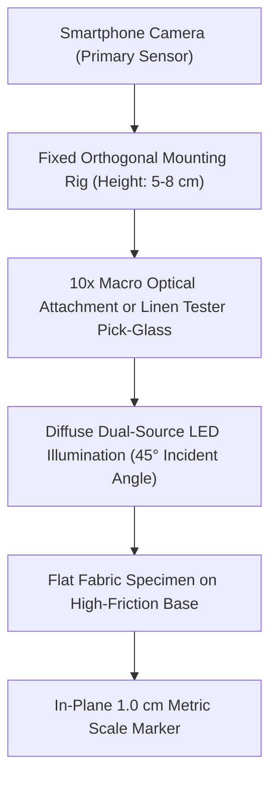

# Client Smartphone Fabric Capture & Calibration Protocol
**Warp & Weft AI — Standard Operating Procedure for Factory Smartphone Optical Inspection**

---

## 1. Scope & Physical Objectives

This protocol establishes the standardized procedure for capturing high-resolution smartphone photographs of textile fabrics to enable automated, certified thread density analysis within factory acceptance tolerance ($\pm 2.0\text{ threads/cm}$).

Standard handheld consumer photography introduces uncalibrated working distances, out-of-plane perspective tilt, non-uniform flash flare, and motion blur. This protocol defines the physical constraints required to transform a standard smartphone into an optical measurement instrument.

---

## 2. Hardware Acquisition Setup

### 2.1. Optical Mounting & Distance Lock
1. **Orthogonal Mounting Rig:** The smartphone must be mounted parallel to the fabric surface on a rigid tabletop stand. Freehand captures are prohibited for certified compliance testing.
2. **Working Distance:** Fixed at $5.0\text{ to }8.0\text{ cm}$ (or $4.5\text{ cm}$ when using a folding linen tester pick-glass).
3. **Macro Optical Attachment:** A $10\times$ optical macro lens attachment (or $1\times 1\text{ cm}$ aperture folding pick-glass) must be positioned over the camera's primary sensor. Digital pinch-to-zoom is strictly prohibited because it interpolates pixel values without increasing optical resolution.

### 2.2. Illumination Protocol
1. **Source:** Dual diffuse LED illumination positioned at $45^\circ$ angles relative to the fabric surface.
2. **Flash Ban:** Camera on-axis Xenon/LED flash must be permanently disabled to prevent intense specular hotspots and shadow blooming.
3. **Transmission vs. Reflection:**
   - **Reflected Light (Standard):** Resolves surface float geometry and crowns on plain and twill weaves.
   - **Transmitted Back-Light (Dense Fabrics / Satin):** Placing a diffuse light table beneath the fabric reveals inter-yarn interstices, eliminating surface float ambiguity.

---

## 3. Optical Nyquist Sampling Resolution Invariants

To achieve $\pm 2.0\text{ threads/cm}$ accuracy, the optical system must provide sufficient pixel density across individual yarn bodies:

$$\text{Nyquist-Shannon Requirement:}\quad K \ge 8\text{ to }12\text{ pixels per yarn period}$$

$$\text{Minimum Sensor Scale:}\quad S \ge N_{\text{threads/cm}} \times 8\text{ px/thread}$$

### Resolution Thresholds by Fabric Classification:
| Fabric Density Class | Density Range | Yarn Period ($P$) | Minimum Pixel Scale ($S_{\min}$) | Minimum Native Sensor Resolution |
| :--- | :--- | :--- | :--- | :--- |
| **Coarse (Canvas / Gauze)** | $10\text{--}20\text{ threads/cm}$ | $500\text{--}1000\,\mu\text{m}$ | $160\text{ px/cm}$ | $1200 \times 1600\text{ px}$ |
| **Medium (Shirting / Denim)** | $25\text{--}45\text{ threads/cm}$ | $220\text{--}400\,\mu\text{m}$ | $250\text{ px/cm}$ | $1200 \times 1600\text{ px}$ with $10\times$ macro |
| **Fine (Poplin / Percale)** | $50\text{--}80\text{ threads/cm}$ | $125\text{--}200\,\mu\text{m}$ | $500\text{ px/cm}$ | USB Microscope or High-DPI Scanner |

---

## 4. In-Plane Physical Calibration Workflow

A physical measurement cannot be derived from pixel coordinates without verified metric scale ($S_x, S_y\text{ in px/cm}$).

### Procedure A: In-Frame Metric Reference Calibration
1. Place a certified $1.0\text{ cm}$ optical graticule or stainless-steel machinist scale in the same physical plane as the fabric specimen.
2. In the web interface, use the Two-Point Calibration Tool:
   - Click the left edge of the $1.0\text{ cm}$ graduation ($x_1, y_1$).
   - Click the right edge of the $1.0\text{ cm}$ graduation ($x_2, y_2$).
   - The system computes:
     $$S_x = \frac{|x_2 - x_1|}{1.0\text{ cm}},\quad S_y = \frac{|y_2 - y_1|}{1.0\text{ cm}}$$
3. The calibration profile records the operator, date, device, and estimated uncertainty ($\le 2.0\%$).

### Procedure B: Stored Setup Profile
1. For fixed inspection stands, calibrate the setup once using a precision stage target.
2. Save as a named profile (e.g. `smartphone_macro_stand_v1`).
3. Select this profile from the application dropdown. Any change in stand height, lens focus, or camera model invalidates the profile and mandates recalibration.

---

## 5. Five-Region Measurement Workflow

The client's official procedure mandates 5 independent region observations per specimen:

### Option 1: Macro-Tiled Single High-Resolution Image
- Capture a single high-resolution photograph ($> 1200 \times 1600$) covering the entire swatch.
- The web interface allows positioning five distinct $1.0 \times 1.0\text{ cm}$ Region-of-Interest (ROI) boxes across the 4 quadrants and center.
- The system processes each ROI independently and reports individual region counts and specimen-level statistics.

### Option 2: Five Independent Region Photographs
- Capture 5 separate close-up macro photographs of the 5 physically marked locations.
- Upload all 5 files in the multi-region mode.
- The system validates each image, aggregates the 5 readings, computes $\bar{x}_{\text{warp}}, \bar{x}_{\text{weft}}, s_{\text{warp}}, s_{\text{weft}}$, and verifies whether the specimen satisfies the $\pm 2.0\text{ threads/cm}$ tolerance.
